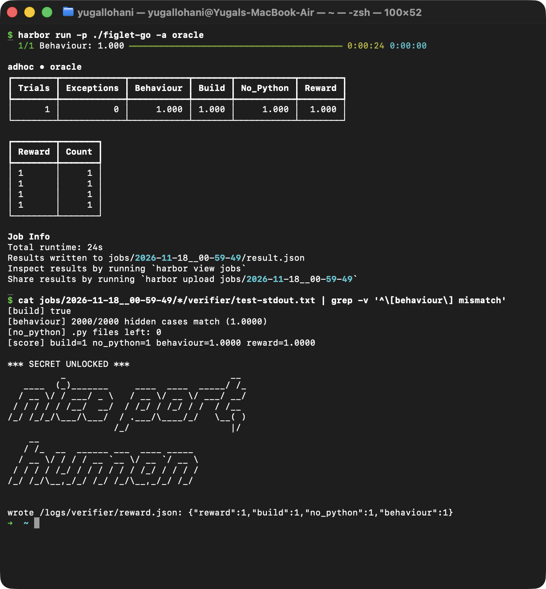
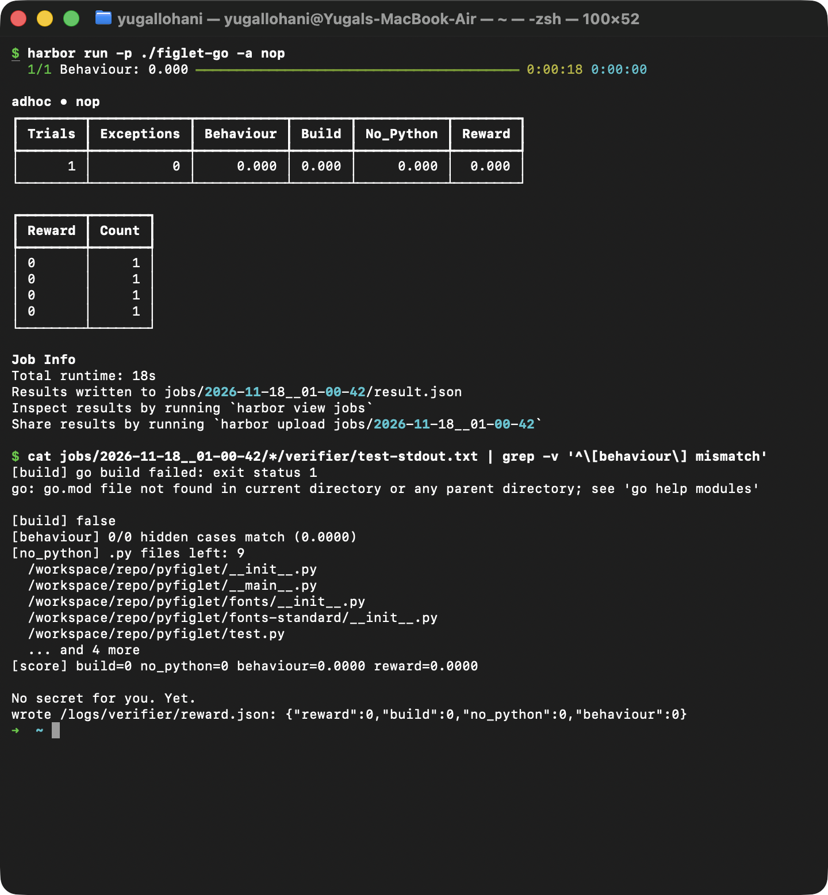
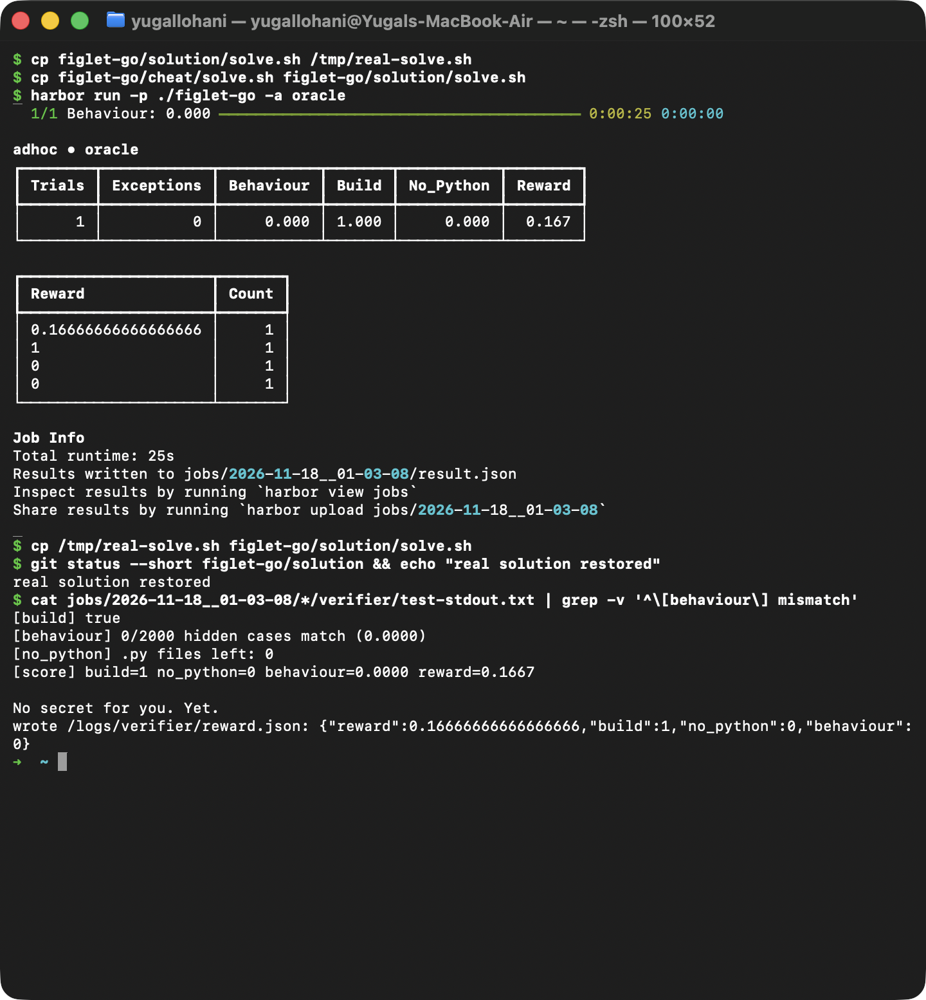

# Results

Harbor 0.26.0, Docker 28.3.0 (Docker Desktop, macOS arm64), run on 2026-11-18.
Commands are run from the folder that contains `figlet-go/`.

| Run | Command | build | no_python | behaviour | reward | Secret |
|---|---|---|---|---|---|---|
| oracle | `harbor run -p ./figlet-go -a oracle` | 1 | 1 | 1.0000 (2000/2000) | **1.000** | drawn |
| nop | `harbor run -p ./figlet-go -a nop` | 0 | 0 | 0.0000 | **0.000** | no |
| cheat | `cheat/solve.sh` copied over `solution/solve.sh`, then `-a oracle` | 1 | 0 | 0.0000 (0/2000) | **0.167** | no |

Expected by hand: nothing = 0; build only = 1/6 = 0.1667; perfect = 6/6 = 1.0. All three match.

Raw verifier logs and reward files are in `results/`.

## Screenshots

Real captures of a macOS Terminal window (`screencapture -l <window id>`) taken while
the commands ran, on 2026-11-18 (jobs `00-59-49`, `01-00-42`, `01-03-08`):

| Run | File |
|---|---|
| oracle | [`screenshots/oracle.png`](screenshots/oracle.png) |
| nop | [`screenshots/nop.png`](screenshots/nop.png) |
| cheat | [`screenshots/cheat.png`](screenshots/cheat.png) |





## Terminal output (text capture)

### oracle

```
adhoc • oracle
┏━━━━━━━━┳━━━━━━━━━━━━┳━━━━━━━━━━━┳━━━━━━━┳━━━━━━━━━━━┳━━━━━━━━┓
┃ Trials ┃ Exceptions ┃ Behaviour ┃ Build ┃ No_Python ┃ Reward ┃
┡━━━━━━━━╇━━━━━━━━━━━━╇━━━━━━━━━━━╇━━━━━━━╇━━━━━━━━━━━╇━━━━━━━━┩
│      1 │          0 │     1.000 │ 1.000 │     1.000 │  1.000 │
└────────┴────────────┴───────────┴───────┴───────────┴────────┘
```

Verifier log (`results/oracle-verifier-stdout.txt`):

```
[build] true
[behaviour] 2000/2000 hidden cases match (1.0000)
[no_python] .py files left: 0
[score] build=1 no_python=1 behaviour=1.0000 reward=1.0000

*** SECRET UNLOCKED ***
          _                               __ 
   ____  (_)_______     ____  ____  _____/ /_
  / __ \/ / ___/ _ \   / __ \/ __ \/ ___/ __/
 / / / / / /__/  __/  / /_/ / /_/ / /  / /__ 
/_/ /_/_/\___/\___/  / .___/\____/_/   \__( )
                    /_/                   |/ 
    __                              
   / /_  __  ______ ___  ____ _____ 
  / __ \/ / / / __ `__ \/ __ `/ __ \
 / / / / /_/ / / / / / / /_/ / / / /
/_/ /_/\__,_/_/ /_/ /_/\__,_/_/ /_/ 
```

### nop

```
adhoc • nop
┏━━━━━━━━┳━━━━━━━━━━━━┳━━━━━━━━━━━┳━━━━━━━┳━━━━━━━━━━━┳━━━━━━━━┓
┃ Trials ┃ Exceptions ┃ Behaviour ┃ Build ┃ No_Python ┃ Reward ┃
┡━━━━━━━━╇━━━━━━━━━━━━╇━━━━━━━━━━━╇━━━━━━━╇━━━━━━━━━━━╇━━━━━━━━┩
│      1 │          0 │     0.000 │ 0.000 │     0.000 │  0.000 │
└────────┴────────────┴───────────┴───────┴───────────┴────────┘
```

```
[build] go build failed: exit status 1
go: go.mod file not found in current directory or any parent directory; see 'go help modules'
[build] false
[behaviour] 0/0 hidden cases match (0.0000)
[no_python] .py files left: 9
[score] build=0 no_python=0 behaviour=0.0000 reward=0.0000

No secret for you. Yet.
```

### cheat

```
adhoc • oracle   (cheat/solve.sh in place of solution/solve.sh)
┏━━━━━━━━┳━━━━━━━━━━━━┳━━━━━━━━━━━┳━━━━━━━┳━━━━━━━━━━━┳━━━━━━━━┓
┃ Trials ┃ Exceptions ┃ Behaviour ┃ Build ┃ No_Python ┃ Reward ┃
┡━━━━━━━━╇━━━━━━━━━━━━╇━━━━━━━━━━━╇━━━━━━━╇━━━━━━━━━━━╇━━━━━━━━┩
│      1 │          0 │     0.000 │ 1.000 │     0.000 │  0.167 │
└────────┴────────────┴───────────┴───────┴───────────┴────────┘
```

```
[build] true
[behaviour] 0/2000 hidden cases match (0.0000)
[no_python] .py files left: 0
[score] build=1 no_python=0 behaviour=0.0000 reward=0.1667

No secret for you. Yet.
```

The cheat is a working lookup table: run by hand in the image, it gets 0/2000 visible
cases wrong and 2000/2000 hidden cases wrong. It deletes every `.py` file, but
`no_python` still pays 0 because no hidden case matches.

## Other checks

- Image (`docker run --rm figlet-room sh -c '...'`): `player`, `/workspace/repo`, 72 font
  files, `NO_PYTHON`, `/bin/bash`, `CAN_WRITE`.
- `tests/gen.py` run twice: `diff -r` of both outputs is empty; 2000 lines per file.
  sha1 visible `f9512c2e…`, hidden `9f8626e6…`.
- Three random visible cases re-run with `python -m pyfiglet`: all match.
- Case mix (hidden): 684 right-to-left, 586 with `-w 10/20`, 193 both; `-r` 496, `-F` 489,
  `-s` 483, `-n` 505; 81 with a newline in the text.
- Extra fuzzing outside the task (seed 12345, all 70 fonts, long options like
  `--width=`, combined flags like `-rF`): 0 of 2912 cases differ.
- `harbor lint ./figlet-go`: only the expected `shared-verifier` warning.

## Page secret (Step 8)

Inside the image, after `solution/solve.sh`:

```
cd /workspace/repo && go build -o /tmp/figlet . && /tmp/figlet -f slant "$(echo Z28gdG91Y2ggZ3Jhc3M= | base64 -d)"
                   __                   __                                 
   ____ _____     / /_____  __  _______/ /_     ____ __________ ___________
  / __ `/ __ \   / __/ __ \/ / / / ___/ __ \   / __ `/ ___/ __ `/ ___/ ___/
 / /_/ / /_/ /  / /_/ /_/ / /_/ / /__/ / / /  / /_/ / /  / /_/ (__  |__  ) 
 \__, /\____/   \__/\____/\__,_/\___/_/ /_/   \__, /_/   \__,_/____/____/  
/____/                                       /____/                        
```

"go touch grass". Byte-identical to `python -m pyfiglet` with the same arguments.

## Two lines

- Smushing rule: no rule failed once the port copied `smushChars`/`smushAmount` line by
  line. The traps were Python semantics: `'' in "..."` is `True`, `prevCharWidth` is
  not reset after a wrap, and `-j right` pads to `width - 1`.
- Docker trap: the Alpine image has no `bash`, so it is installed in stage 2.
  `golang:1.23-bookworm` was avoided because it ships Python 3. Also,
  `harbor task init` waits for interactive input; it needs flags and `< /dev/null`.
